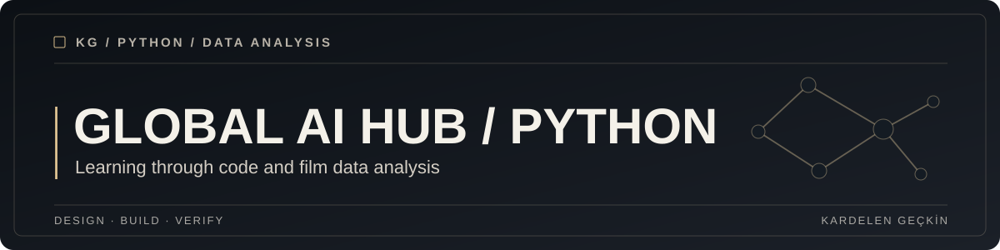

**An educational Python repository with a Netflix film ratings analysis notebook and a student grading exercise.**

[Explore the materials](#explore-the-materials) · [Getting started](#getting-started) · [Validation](#validation)

## Overview

Coursework from a Global AI Hub Python Bootcamp, featuring a film data analysis notebook and a small student grading script.

## What it includes

* [Netflix film analysis](Netflix_Original_Films_%26_IMDB_Scores.ipynb), an exploratory notebook using film data and IMDb scores.
* [Student grading system](OgrenciNotSistemi.py), a small Python programming exercise.
* Notebook-based analysis and visualization work from the bootcamp.

## Explore the materials

| Item | Format | Description |
| --- | --- | --- |
| [Netflix Original Films and IMDb Scores](Netflix_Original_Films_%26_IMDB_Scores.ipynb) | Notebook | Data exploration and visualization |
| [OgrenciNotSistemi.py](OgrenciNotSistemi.py) | Python | Student grading exercise |

## Getting started

Run the Python exercise with a compatible Python 3 installation:

~~~bash
python OgrenciNotSistemi.py
~~~

Open the notebook in JupyterLab or a notebook-compatible IDE. Install its required packages after reviewing the imports. A verified environment lockfile is not yet part of this educational archive.

## Repository structure

~~~text
Global_AI_Hub_Python_Bootcamp/
├── Netflix_Original_Films_&_IMDB_Scores.ipynb
├── OgrenciNotSistemi.py
├── docs/assets/
└── README.md
~~~

## Validation

No automated unit tests are currently present. The notebook's output and data availability should be validated in a local Python environment.

## Architecture & decisions

Each artifact is kept as an independent course exercise. There is no production service, database or shared application backend.

## Security & limitations

This is a learning archive. Dataset reuse rights and dependencies should be checked independently, and notebook outputs should not be treated as current entertainment statistics.

## License

No repository license file was found. Reuse and redistribution permissions have not been established.
